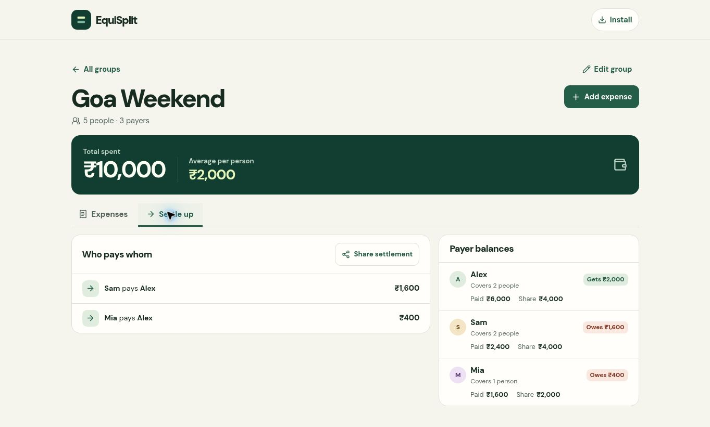
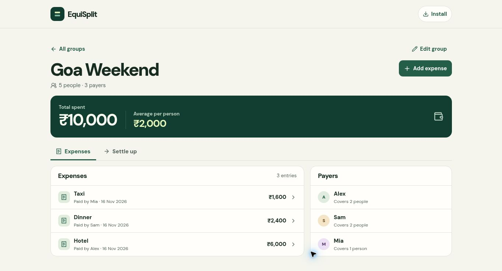

# EquiSplit Web

<!-- README SHOWCASE START -->

<div align="center">

[**Open EquiSplit on Vercel**](https://equisplit-web.vercel.app/) &nbsp;·&nbsp; [**Install on iPhone**](#install-on-iphone) &nbsp;·&nbsp; [**Android app**](https://github.com/MRPRANAVPATEL/EquiSplit)


[](https://equisplit-web.vercel.app/)

[](https://equisplit-web.vercel.app/)

</div>

*The Settle up screen for a sample five-person Goa Weekend group.*

<!-- README SHOWCASE END -->

**Thoughtfully built by Pranav Patel to solve everyday problems.**

EquiSplit is a mobile-first web app built with React, TypeScript, and Vite for splitting bills on trips, at dinners, and on group outings. Set how many people each payer covers, log expenses in rupees, and share who owes whom. Add it to your iPhone Home Screen and use it offline after the first load. Your data stays on your device.

> Built for personal use and web development practice. Install it at your own discretion.

## Install on iPhone

1. Open [EquiSplit](https://equisplit-web.vercel.app/) in **Safari**.
2. Open **Share** and choose **Add to Home Screen**.
3. If Safari shows **Open as Web App**, turn it on and tap **Add**.
4. Open the EquiSplit icon while online once so the service worker can prepare the app for offline use.

You can also use **Install** in EquiSplit on browsers that offer an install prompt.

## Split a group bill

1. Create a group and enter the total number of people sharing the bills.
2. Add the payers and set how many people each one covers, including themselves.
3. Record each bill’s amount, date, description, and payer. Open any entry to edit or delete it.
4. Open **Settle up** to see what each person owes or gets back. Select **Share settlement** to send or copy the summary.



EquiSplit uses the same whole-paise rounding and settlement rules as the [Android app](https://github.com/MRPRANAVPATEL/EquiSplit). Each browser or installed Home Screen app keeps its own groups and expenses on the device.

## Technology

| Technology | What it does |
| --- | --- |
| React | Group, expense, and settlement screens |
| TypeScript | Validated data and exact paise calculations |
| Vite | Development server and production build |
| Flexbox CSS | Responsive layouts for phones, tablets, and desktops |
| IndexedDB | On-device storage for groups, payers, and expenses |
| Vite PWA and Workbox | Home Screen installation and offline access |

## Run locally

Use Node.js 22.12 or later.

```sh
git clone https://github.com/MRPRANAVPATEL/EquiSplit-web.git
cd EquiSplit-web
npm ci
npm run dev
```

Run the tests and preview the production build to check offline use.

```sh
npm test
npm run build
npm run preview
```

## Deploy to Vercel

Import the repository in Vercel. The Vite build command is `npm run build` and the output directory is `dist`. The repository already includes these settings in [vercel.json](./vercel.json).

---

*Thoughtfully built by Pranav Patel to make splitting bills with friends and family easier.*
